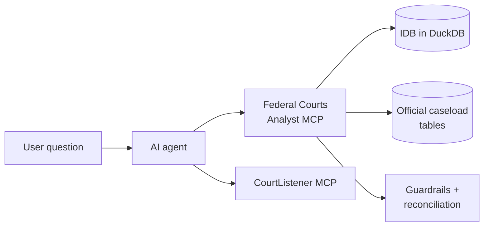

# Federal Courts Analyst — MCP Hackathon Concept

Sep 23, 2026

We propose Federal Courts Analyst: an MCP server that answers plain-language questions about federal court workload. For recent years the judiciary publishes more than one official figure for the same statistic, and our server knows which edition each number comes from and why they differ. No existing MCP server offers aggregate federal court statistics this way.

## The hackathon

We're proposing to enter GSA's [MCP Server and AI Agent Government Hackathon](https://www.gsa.gov/artificial-intelligence/ai-community-of-practice/events-and-training/mcp-server-and-ai-agent-government-hackathon), a virtual event running September to November 2026.

- **Task:** build a prototype MCP server over public government data or services, in a sandbox. Tracks: Dataset Access, Service Read, or Service Write. We'd enter **Dataset Access**.
- **Eligibility and registration (blocking):** in July the page said "federal employees and contractors (you must have a government email)." It now says only "government employees with a .gov or .mil email," and registration appears to be closed. We need written confirmation from GSA before investing, and an AO federal employee as our lead of record. Teams can have up to five people, mixing engineers and domain experts.
- **Partners:** Databricks, OpenAI, IBM. Prizes are recognition only, presented by senior officials.

**Judging criteria**

| Criterion | What the judges look for |
| --- | --- |
| Technical quality | Readable, modular code; our own evaluation setup and results; MCP design principles (Pydantic inputs, precise tool descriptions, goal-oriented tools rather than thin REST wrappers) |
| Innovation | Creative use of MCP tooling and novel agent workflows |
| Mission alignment | Supports mission needs, service delivery and oversight |
| Presentation | Clear story, smooth demo, evidence of testing |

**Deliverables:** a GitHub repo built on [GSA's template](https://github.com/GSA-TTS/mcp-hackathon-template), a slide deck (problem, solution, technical approach, demo), and an evaluation document (methodology, metrics, security, lessons learned). The template uses FastMCP with one tool per file and Pydantic models, and ships deployment kits for Databricks and IBM watsonx Orchestrate plus evaluation kits (Databricks MLflow, Phoenix). GSA estimates about 40 hours, half of it on evaluation.

**Key dates (Eastern time; the final deadline hasn't been announced)**

| Date | Event |
| --- | --- |
| Sep 23, 12:30 p.m. | MCP 101 |
| Sep 29 and Oct 6, 12:30 p.m. | Databricks sessions |
| Oct 1 and Oct 8, 12:30 p.m. | IBM sessions |
| Oct 13, 12:30 p.m. | Kickoff ceremony |
| Thursdays Oct 15 to Nov 19, 3 p.m. | GSA office hours |
| Oct 29, 12:30 p.m. | MCP 201 |
| Nov 3, 12:30 p.m. | Halfway check-in |

## Landscape: what already exists

Case-law and docket search is already well covered, so we should build on top of it rather than compete with it.

- **CourtListener's official MCP server** (Free Law Project, in Anthropic's connector directory since May 2026) offers search, citation analysis, and alerts, plus a generic escape hatch to any CourtListener API endpoint. That escape hatch can reach CourtListener's IDB records, but only civil cases, matched to dockets by fuzzy automated matching. Several community forks and paid wrappers also exist, all focused on dockets and opinions.
- **GSA's own reference server (CDC PLACES) already attaches a citation to every response.** Citations are the baseline the organizers expect, not a differentiator.
- **The gap is aggregate statistics.** No MCP server we found serves the official uscourts.gov caseload tables, tracks their editions, or reconciles them. The [tables](https://www.uscourts.gov/statistics-reports/caseload-statistics-data-tables) are scattered xlsx and PDF files with codes (C-2, X-1A) and mixed reporting periods. The [FJC Integrated Database (IDB)](https://www.fjc.gov/research/idb) holds case-level civil, criminal, appellate, and bankruptcy data, but it's roughly 22 GiB of coded bulk files, and judge identifiers are removed by Judicial Conference policy.

An AI agent can't answer "which districts are most overloaded per judgeship?" today without a person working through spreadsheets. That's the gap we fill.

## The concept: Federal Courts Analyst

We'd build an MCP server that works like a statistical analyst for the federal judiciary. Every number it returns is reconciled against official published tables and carries its provenance.

Most AI-over-data demos return a number and hope it's right. Here's a real example of why that fails. Ask "How busy were federal district courts in FY2020?" and official sources give four different figures:

| FY2020 measure | Per judgeship | Source |
| --- | --- | --- |
| Unweighted civil filings (673 judgeships) | 676 | [Judicial Business 2020, Table X-1A](https://www.uscourts.gov/sites/default/files/data_tables/jb_x1a_0930.2020.pdf) |
| Unweighted civil filings (674 judgeships) | 675 | [Judicial Facts and Figures, Table 6.2](https://www.uscourts.gov/sites/default/files/data_tables/jff_6.2_0930.2023.pdf), 2023 edition onward |
| Weighted civil filings, as first published | 554 | Judicial Business 2020, Table X-1A (repeated in the 2021 and 2022 JFF editions) |
| Weighted civil filings, current series | 322 | Judicial Facts and Figures, Table 6.2, 2023 edition onward |

FY2020 civil filings surged because more than 200,000 3M earplug MDL cases were filed directly in the Northern District of Florida. Starting with its 2023 edition, Judicial Facts and Figures revised the weighted series downward, and the same happens for later years. So for each recent year the judiciary publishes two official weighted figures, and no published note explains the difference.

N.D. Florida alone accounts for about 211 of the 232-point drop, which suggests directly filed MDL cases were excluded or down-weighted. That is our inference, not an official statement, so it must be confirmed with AO statistics staff. An LLM with web search would mix these numbers together. Our server returns each one with its definition, edition, and the reason it differs.

**Provenance on every answer:** source table, edition (vintage), reporting period, definition, and a reconciliation check.

**Data sources**

| Source | Role | Format |
| --- | --- | --- |
| FJC IDB | Case-level engine for flexible cohort queries | Bulk files, loaded into DuckDB with all codes decoded |
| uscourts.gov caseload tables | Authoritative aggregates and reconciliation ground truth | Scraped xlsx, normalized into a table catalog |
| CourtListener MCP (external) | Drill-down to real dockets and opinions | Separate MCP server the agent uses alongside ours |

The agent asks our server for statistics, checks them against official figures, and then uses CourtListener to fetch example dockets.

## Tool design

The tools are built around what an analyst is trying to do, not around the underlying tables, and follow the current MCP spec (2026-07-28). We're keeping the tool set deliberately small, about eight.

**Tools**

| Tool | What it does |
| --- | --- |
| `explain_change(measure, court, period)` | **Flagship tool.** Breaks a change down by district and case type and flags known drivers. It uses the IDB origin code for MDL cases filed directly in a district (valid from July 2016) to isolate MDL surges, and also flags the pandemic and methodology revisions |
| `get_official_figure(measure, period, edition?)` | Returns a published figure with its table, edition, and definition, plus every later revision |
| `reconcile(handle)` | Checks IDB-derived numbers against the matching official table and explains the variance |
| `compare_courts(metric, courts, period)` | Cross-court comparison. Weighted filings come from the official tables, because the current 2016 FJC case weights aren't fully published |
| `find_cases(filters)` / `analyze_cohort(handle, metric)` | Builds a cohort and returns a **cohort handle**; analysis returns time to disposition, outcome rates, and trends with confidence intervals and sample sizes |
| `judgeship_context(court)` | Official weighted filings against the Judicial Conference's 430 and 600 thresholds, emergency status, and official recommendations, each tagged by edition. It makes no recommendations of its own |
| `explain_term(term)` | Translates codes and metrics ("nature of suit 442", "weighted filings", "directly filed MDL") |
| `sample_dockets(handle, n)` | Returns docket identifiers for CourtListener lookups, labeled "match may be inexact" |

**Beyond tools**

- **Cohort handles:** the agent refines an analysis over several turns without pushing thousands of rows through the context window. The 2026-07-28 spec explicitly recommends this explicit-handle pattern, which is worth a slide.
- **Structured outputs:** every tool declares an output schema built on one shared Pydantic `Provenance` model (table, edition, period, definition, series, revision status).
- **Resources:** codebooks, methodology notes, the table catalog, and a revision log. Edition-locked resources are marked cacheable, since a published edition never changes.
- **Prompts:** canned analyses such as a "district caseload profile" or a "what changed and why" briefing.
- **Elicitation (optional):** asks the user to clarify ambiguous terms, such as fiscal year versus statistical year, or raw versus weighted filings. If the client doesn't support the new elicitation flow, the tool returns a structured "please clarify" response instead.
- **MCP Apps (optional):** results render as an inline chart with provenance badges in Claude, ChatGPT, and VS Code. Every chart falls back to a table plus text, since watsonx Orchestrate and Databricks may not render it.
- **Not used:** sampling, which the 2026-07-28 spec deprecates.
- **Pydantic models** for every input and output, with enums for courts, case types, and editions so the LLM can't make up values.

## Guardrails, security and PII

The server should know which conclusions it shouldn't draw. That's our strongest innovation angle and it also fills the security section of the evaluation document.

- **Small-cell warnings:** flag or refuse results when n < 30 (threshold to be decided).
- **Data-break awareness:** warn when a query spans known codebook or collection changes in the IDB, or when a published figure was revised in a later edition. The server never mixes vintages silently.
- **No judge-level rankings:** consistent with the FJC's own policy against enabling judge-shopping. The server declines and explains why.
- **PII-aware output:** the IDB includes party names. Aggregate outputs suppress individual names by default, following FRCP 5.2-style redaction principles.
- **Read-only, sandboxed, public data only:** nothing from internal judiciary systems and no internal knowledge from anyone's day job. *(Amended by [ADR 0013](docs/adr/0013-request-desk.md), proposed: the official data stays read-only; a sandboxed request desk may write its own records, and nothing is sent outside.)*
- **Prompt-injection hygiene:** CourtListener results are treated as untrusted data.

## Evaluation plan

Evaluation is about half of GSA's estimated effort, so it's where we can win. We build on the template's own evaluation kits (Databricks MLflow and Phoenix), which the judges will recognize. Numbers are scored deterministically against official figures rather than by an LLM judge, and an answer only counts as correct if it names the right edition. We use a held-out test split and report errors using the MCP-Atlas categories (tool usage versus task understanding).

| Eval suite | What it tests | Metric |
| --- | --- | --- |
| IDB engine accuracy | Figures computed from IDB rows, compared with official tables they were not taken from | Variance per table and period, with explained versus unexplained gaps |
| End-to-end agent | Natural-language questions with known official answers | Numeric accuracy (exact and within tolerance) with the correct edition; claims-based checks for explanations (for example "flags the series revision") |
| Baselines | The same questions answered by (a) the same model with web search, and (b) a Databricks Genie space over the identical tables | Accuracy lift of our server over each baseline |
| Tool selection | Whether models pick the right tool from the descriptions | Selection accuracy across at least two model families |
| Adversarial | Ambiguity, judge-level requests, small samples, and edition traps (554 vs 322, 673 vs 674 judgeships, statistical year vs fiscal year before 1993) | Refusal and clarification precision and recall |
| Performance | Query latency and error handling | p50/p95 latency, graceful-failure rate |

The headline result is lift over Genie: generic text-to-SQL over the same tables versus our server. It answers the question a Databricks judge will ask, which is why not just use Genie. The results feed a small dashboard for the evaluation document and the demo's closing slide. A published variance report between the IDB and official tables is a useful byproduct.

## Mission alignment and demo

The mission story is transparency about court workload. Congressional staff, journalists, researchers, and court administrators regularly ask how busy the courts are and why, and today the answer is buried in spreadsheets and methodology footnotes. We keep the framing neutral: the tool explains official statistics and doesn't argue for policy outcomes such as new judgeships.

The stakes are real. The Judicial Conference generally looks for more than 430 weighted filings per judgeship before recommending a new judgeship, and above 600 marks a judicial emergency ([CRS Insight IN12541](https://www.congress.gov/crs-product/IN12541)). Congress is weighing new judgeships under the JUDGES Act of 2025, so a figure that officially moved from 554 to 322 matters.

**Demo storyline (about 5 minutes)**

1. Plain-language question: "Why did federal civil filings jump in FY2020?" The server uses elicitation to ask whether the user means all civil cases or only weighted-eligible ones.
2. explain\_change traces most of the jump to one district and one case type (directly filed 3M earplug MDL cases), with provenance and a reconciliation badge.
3. An inline MCP App chart shows raw versus weighted filings and flags that the FY2020 weighted figure was revised in a later edition.
4. The agent pulls three real example dockets through CourtListener, including the MDL master docket.
5. We try to get it to rank individual judges. It declines and explains why.
6. Close on the eval dashboard: accuracy with our server versus web search alone and versus Genie, across several models.

Before we present, AO statistics staff should review this storyline, especially the revision narrative. The framing is "the server never mixes series," not "the AO's numbers disagree."

## Risks

| Risk | Why it matters | Mitigation |
| --- | --- | --- |
| Eligibility and registration | Rules changed from "employees and contractors" to "government employees"; registration appears closed | Written confirmation from GSA; an AO federal employee as lead of record; contracting officer sign-off; work outside billable hours unless approved |
| Agency sensitivity | We'd highlight an undocumented revision in AO statistics | AO statistics staff review before we present; neutral framing |
| Unconfirmed inference | The MDL explanation for the 554-to-322 revision is ours | Label it "inferred, unconfirmed" until the AO confirms |
| Novelty challenge | CourtListener's MCP can already reach civil IDB records | Point to aggregate tables, edition tracking, reconciliation, and the Genie baseline |
| Data wrangling | The IDB is roughly 22 GiB with changing codebooks; tables span many editions | Ship a reproducible subset (civil, FY2015 to FY2025) plus a build script |
| Reconciliation gaps | IDB and official tables may never match exactly | Document explained variance; the variance report is itself a deliverable |
| Party names in IDB | PII exposure in outputs | Suppress by default; aggregate-only outputs |
| Client support | MCP Apps and the new elicitation flow may not work in watsonx Orchestrate or Databricks | Text fallbacks; demo in Claude or VS Code; confirm which spec version the template's FastMCP supports |

## Team, workstreams and open questions

We need up to five people, including at least one domain expert in court statistics, such as a statistician, a law librarian, or a researcher who uses the IDB. IDB ingestion, the edition-aware table catalog, and the eval benchmark come first because everything else depends on them.

| Workstream | Scope | Owner |
| --- | --- | --- |
| Data ingestion | IDB into DuckDB, code decoding, caseload table scraper, and a catalog that tracks editions and revisions |  |
| MCP server | Tools, Pydantic models, cohort handles, resources, prompts, elicitation |  |
| Guardrails and security | Small-cell rules, PII suppression, data-break detection |  |
| Evaluation | Benchmark with deterministic scoring, web-search and Genie baselines, MLflow/Phoenix kits, dashboard |  |
| Domain and story | Metric definitions, mission framing, deck and demo script |  |

**Open questions for brainstorming**

- [ ] Confirm eligibility and registration status with GSA in writing, plus employer, contracting officer, and AO sign-off.
- [ ] Who is our AO federal employee lead of record, and who is our court-statistics domain expert?
- [ ] Can AO statistics staff explain the weighted-series revision that began with the 2023 Judicial Facts and Figures?
- [ ] Default edition: the latest revised figure, or the figure as first published?
- [ ] Scope: civil FY2015 to FY2025 first, adding criminal only if time allows?
- [ ] Which small-cell threshold and suppression rules should we adopt?
- [ ] Is the CourtListener handoff part of the core demo or a stretch goal?
- [ ] Deploy through the template's Databricks kit and register in IBM ContextForge for cross-platform credit?
- [ ] A better name than "Federal Courts Analyst"?

## Sources

- [GSA MCP Server and AI Agent Government Hackathon](https://www.gsa.gov/artificial-intelligence/ai-community-of-practice/events-and-training/mcp-server-and-ai-agent-government-hackathon)
- [GSA-TTS MCP hackathon template](https://github.com/GSA-TTS/mcp-hackathon-template)
- [CourtListener MCP server README](https://github.com/freelawproject/courtlistener-api-client/blob/main/MCP_README.md)
- [Judicial Business 2020, Table X-1A](https://www.uscourts.gov/sites/default/files/data_tables/jb_x1a_0930.2020.pdf)
- [Judicial Facts and Figures, Table 6.2 (2023 edition)](https://www.uscourts.gov/sites/default/files/data_tables/jff_6.2_0930.2023.pdf)
- [FJC IDB Research Guide](https://www.fjc.gov/sites/default/files/IDB-Research-Guide.pdf)
- [CRS Insight IN12541: Judicial Conference judgeship recommendations](https://www.congress.gov/crs-product/IN12541)
- [MCP 2026-07-28 specification release notes](https://blog.modelcontextprotocol.io/posts/2026-07-28-release-candidate/)
- [MCP Apps announcement](https://blog.modelcontextprotocol.io/posts/2026-01-26-mcp-apps/)
