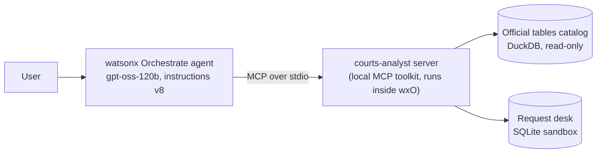

# Federal Courts Analyst

**An MCP server and a watsonx Orchestrate agent that give the official
federal court caseload statistics, with the edition each number was
published in.**

Ask "how busy were the federal courts in FY2020?" and you can get four
official answers. The judiciary publishes the same statistic in several
editions of its tables and revises it between them. National weighted civil
filings per judgeship for FY2020 were **first published as 554** (Judicial
Business 2020, repeated through 2022) and **revised to 322** (Judicial Facts
and Figures 2023 onward). N.D. Fla. accounts for about 211 of the 232-point
drop: in FY2020 over 200,000 cases of the 3M earplug multidistrict
litigation were filed directly there, which suggests the revision excluded or
down-weighted them. No published note says so, and the server labels that
explanation *inferred* until the AO confirms it. A search engine
or a general-purpose assistant mixes
these figures from different editions without noticing. This server never
does that. Every figure comes with its edition and table, the
first-published value and why the editions differ.

Built for GSA's [MCP Server and SI Agent Government Hackathon](https://www.gsa.gov/super-intelligence/si-community-of-practice/events-and-training/mcp-server-and-si-agent-government-hackathon),
on the [GSA MCP hackathon template](https://github.com/GSA-TTS/mcp-hackathon-template),
in IBM's environment: the IBM Bob IDE on a TechZone VM, with the agent in
**watsonx Orchestrate**.

| Hackathon application | What this repository does |
| --- | --- |
| **Dataset access** | Read tools over an edition-aware catalog of the official uscourts.gov tables (FY2016–FY2025, 60 table editions) and the FJC civil Integrated Database |
| **Service "write" integration (sandbox)** | A request desk: a user can keep a checked answer, watch its figures, or ask the statistics office why a figure was revised. Nothing is saved without the user's explicit yes, and nothing reaches the AO or FJC |

## Start here

| | |
| --- | --- |
| **Evaluation summary** | [`eval/SUMMARY.md`](eval/SUMMARY.md): method, results, findings, limits |
| **The watsonx Orchestrate agent** | [Running on watsonx Orchestrate](#running-on-watsonx-orchestrate), instructions [`eval/wxo/instructions/v8.txt`](eval/wxo/instructions/v8.txt) |
| **Check the evaluation yourself** | [`eval/VERIFY.md`](eval/VERIFY.md): re-derive every number from the saved replies in minutes, with no keys or accounts |
| **Reproduce the evaluation** | [`eval/wxo/README.md`](eval/wxo/README.md), `eval/wxo/run_eval.sh` |
| **The request desk** | [`docs/desk.md`](docs/desk.md), [ADR 0013](docs/adr/0013-request-desk.md) |
| **Security** | [`SECURITY.md`](SECURITY.md), [threat model](docs/security/threat-model.md) |
| **Design decisions** | [`docs/adr/`](docs/adr/README.md) |
| **Data sources and methodology** | [`docs/data-sources.md`](docs/data-sources.md), [`docs/methodology/`](docs/methodology/) |
| **Every revised figure** | [`docs/revision-log.md`](docs/revision-log.md) |

## Results

The deployed agent: `courts-analyst-syed` on watsonx Orchestrate, model
`groq/openai/gpt-oss-120b`, instructions v8, 8 of this server's tools. Every
item is asked 3 times and scored **deterministically** against the official
tables (no LLM judge). Full detail in [`eval/SUMMARY.md`](eval/SUMMARY.md).

| Run | Items × repeats | Mean (95% CI) | pass^3 |
| --- | --- | --- | ---: |
| **Held-out `test2`**, written before any agent run, scored once | 45 × 3 | **80.0% (72.5–85.9%)** | 73.3% |
| Dev split, on the deployed server | 117 × 3 | 88.3% (84.5–91.3%) | 80.3% |
| Dev split, draft agent with the 4 case-level tools added (12 tools) | 117 × 3 | 92.9% (89.7–95.1%) | 88.9% |

- **The server is what makes the answers possible.** The same model (Claude
  Sonnet) on the same 117 dev items scored **93.5% with the server and
  20.6% without it**. With the server it got all 38 single-figure answers
  right, each with its edition; without it, none.
- **Figures are reliable.** On held-out, every single-figure answer had the
  official value with the right edition, 3 times out of 3.
- **Saving is safe.** In 36 desk test runs since the server-side check, no
  answer was saved without the user's approval. Before the server-side check, 2 of
  10 runs did.
- **Every tool is evaluated, and the evidence picks the agent's 8.** Claude
  runs on the full server cover the 4 case-level tools. They now run on wxO
  too, from a compact copy of the IDB shipped inside a second toolkit: on
  all 12 tools, dev on the same 117 items was 92.9% (89.7–95.1), pass^3
  88.9%, with the engine items rebuilt from the IDB; on Live 1.2.0, with
  the case-type fix, 88.6% (84.9–91.5) in a second run (EVALUATION.md 3.1). Three step-by-step save tools trust
  the model's `confirm`: in scripted desk conversations Claude Sonnet saved
  before asking in 6 of 6 save conversations with them, and 0 of 15 with
  `keep_answer`'s server-checked preview. Table:
  [`eval/EVALUATION.md`](eval/EVALUATION.md), section 3.12.
- **Main weakness: clarifying.** Asked a vague question ("which court was
  busiest?"), the agent usually picks a measure instead of asking which one
  is meant (1 of 12 times on held-out).

The held-out run used the server build from before the desk fixes. Those
fixes touch only the desk tools, and dev on the deployed build shows no
regression (88.3% against 88.0% before). Dev scores are re-scored after a
scorer fix for thousands separators written as narrow spaces ("297 877");
as first scored they were 85.2% and 86.3%. Held-out was unaffected. A
later fix, found by checking the scorer against an LLM judge, would raise
held-out to 81.5%; we keep 80.0% as the headline because the fix was found
by reading held-out replies.

## How it works



- **Tools are built around what the user wants to know**, not around tables:
  "why did this change", "what is the official figure", "how does this court
  compare". Each returns a Pydantic model, published as the tool's
  `outputSchema`, with provenance (edition, table, first-published value) on
  every figure.
- **The domain logic lives in `core/`**, with no MCP or HTTP imports. The MCP
  tools, the REST API and the web app are thin adapters over the same
  functions ([ADR 0002](docs/adr/0002-core-adapter-architecture.md)).
- **One guardrail layer covers every tool.** No mixing of editions in a
  series, small-cell suppression, factual answers for years not held,
  structured declines for judge-level and party-name requests, an output
  scanner for party names, and neutral wording on judgeship policy.
- **The official data is read-only.** The catalog and the IDB are attached
  `READ_ONLY`; only the desk's separate sandbox store is writable.

## Tools

**Read tools.** ✓ marks the tools attached to the watsonx Orchestrate agent.

| Tool | wxO | Answers |
| --- | :---: | --- |
| `get_official_figure` | ✓ | One published statistic in the latest edition, with the first-published value, every edition and why they differ |
| `explain_change` | ✓ | Why a measure changed between two fiscal years: breakdowns by district and case type, drivers labelled official, IDB-derived or inferred |
| `compare_courts` | ✓ | Courts ranked on one measure, all from one edition |
| `judgeship_context` | ✓ | Weighted filings against the Judicial Conference's 430/600 thresholds and its recommendations, never its own |
| `explain_term` | ✓ | Definitions of terms, measures and nature-of-suit codes |
| `find_cases` / `analyze_cohort` | | A cohort of IDB civil cases; medians, outcome rates and trends with n and 95% CIs |
| `reconcile` | | Whether the IDB reproduces a published count, and why not |
| `sample_dockets` | | Example docket references for CourtListener, labelled "match may be inexact" |
| `server_info` | | Version, protocols and which datasets are loaded |

The case-level tools need the IDB. The full build (440 MB) is larger than
watsonx Orchestrate SaaS accepts in a toolkit upload (413). A compact copy
fits: `make data-idb-slim` keeps every record and only the columns the server
reads, stores the record table as a view over a narrower table, and gives
identical answers (37 MiB zipped with the code and catalog). It is
registered as a second toolkit, `courts_analyst_syed_idb`. Since 2026-11-17
**Live is version 1.2.0** with 12 tools: the 8 ✓ plus these 4, from a third
toolkit, `courts_analyst_syed_v2`. It adds a fix found on Live: asked for a
case type in words ("patent cases"), version 1.1.0 guessed the wrong
nature-of-suit code. Now `explain_term` maps case types to codes, and on 7
new dev items worded that way the agent never used a wrong code (21
attempts).

**Request desk tools** (sandbox, [docs/desk.md](docs/desk.md)). Asking a
question never writes anything.

| Tool | wxO | Does |
| --- | :---: | --- |
| `keep_answer` | ✓ | Checks the answer, then saves it as a verified copy, a watch, or a question to the statistics office |
| `my_requests` | ✓ | The asker's inbox: status, verified answer, the office's response, updates |
| `check_inquiry_eligibility` | ✓ | Whether a figure's revision can go to the statistics office (read-only) |
| `find_published_answers` | | Search approved answers in the public library (read-only) |
| `open_request`, `save_verified_answer`, `file_revision_inquiry` | | The same steps one at a time |
| `inquiry_queue`, `record_official_response`, `publish_answer` | | The simulated statistics office; registered only with `DESK_STAFF_MODE=true` |

Plus 7 resources (`courts://catalog`, `courts://revisions`,
`courts://glossary`, `courts://editions/{edition}/{table}`,
`courts://codebook/{field}`, `courts://methodology/{topic}`,
`desk://library`) and 5 prompts (`district_caseload_profile`,
`what_changed_and_why`, `judgeship_briefing`, `compare_editions`,
`keep_this_answer`). An ambiguous question (raw or weighted filings?) is
asked back through elicitation on clients that support it, and returned as
`needs_clarification` otherwise.

### How the desk keeps a save safe

1. **The user decides.** The agent describes what will be saved and asks
   "Shall I go ahead?". It never calls `keep_answer` on its own initiative.
2. **The server checks the preview.** A `confirm=false` call returns a
   single-use `preview_id` tied to a digest of exactly what would be saved
   (text, option, asker, citations). The `confirm=true` call must pass it
   back, so a changed answer or a retry after a refusal needs a new preview
   and a new yes. The step-by-step tools don't have this check, which is one
   reason they aren't attached to the agent.
3. **The verification gate.** Every number in the answer must be a cited
   figure that matches what its edition printed, a number the server's own
   read tools produce, a published threshold, or a difference between those.
   The figures for each measure must come from consistent editions. A refusal
   names each offending number and what to write instead.
4. **The transcript checker.** The server can't prove the user saw the
   preview, so `courts-eval preview-check` checks every evaluation
   transcript for a confirm without a "Shall I go ahead?" and a yes. It
   caught violations that IBM's own evaluator marked as successful.

## Running on watsonx Orchestrate

The server goes into watsonx Orchestrate as a **local MCP toolkit**:
Orchestrate installs it and runs it over stdio, with no HTTP endpoint or
container. The full runbook is
[`deploy/ibm/local-mcp-toolkit/README.md`](deploy/ibm/local-mcp-toolkit/README.md).

1. Build the catalog: `make data-tables`. For the case-level tools, also
   `make data-idb data-idb-slim`.
2. Configure `deploy/ibm/local-mcp-toolkit/.env` (instance URL, environment
   and toolkit names; no secrets) and put the API key in `WXO_API_KEY`.
3. Register: `deploy/ibm/local-mcp-toolkit/register-toolkit.sh`
   (`INCLUDE_IDB=1` ships the compact IDB). It won't replace an existing
   toolkit unless `REPLACE_EXISTING=1`, because replacing takes its tools off
   every agent. Snapshot, deploy and rollback steps:
   [`ROLLBACK.md`](deploy/ibm/local-mcp-toolkit/ROLLBACK.md).
4. In Orchestrate, create an agent with the model `groq/openai/gpt-oss-120b`,
   attach the 8 tools marked ✓ above, and paste
   [`eval/wxo/instructions/v8.txt`](eval/wxo/instructions/v8.txt) as its
   instructions.

`eval/wxo/agent_check.py` checks that a live agent matches an instruction
file and tool count before an evaluation run.

**The agent** is deployed to Live on our instance and available in
Orchestrate Chat: version 1.2.0 (v8, 12 tools, the case-level tools
included, with the case-type fix) since 2026-11-17. Version 1.0.0, "v8 evaluated, submission" (8
tools), is the configuration held-out test2 measured, and stays in the
version history. Its
**Evaluate** page holds six showcase tests run by IBM's built-in evaluator
(6 of 6 pass): see [`eval/EVALUATION.md`](eval/EVALUATION.md), section 3.7.

## Running locally

Needs [uv](https://docs.astral.sh/uv/) and `make`. Docker is optional.

```bash
make setup        # install dev + pipeline deps, pre-commit hooks, create .env
make test         # pytest with coverage (builds both datasets from committed fixtures)
make data-tables  # download the official tables (≈4 min) and build courts.duckdb
make data-idb     # optional: download the FJC civil IDB (330 MB) and build idb.duckdb (≈1.5 min)
make serve        # MCP over stdio
make serve-http   # MCP over streamable HTTP on :8000 (/mcp, /health, /version)
make help         # every target
```

Any MCP client can connect. For a client that launches stdio servers (Claude
Desktop, VS Code, IBM Bob), add:

```json
{
  "mcpServers": {
    "courts-analyst": {
      "command": "uv",
      "args": ["run", "--quiet", "--directory", "/absolute/path/to/this/repo", "courts-analyst"]
    }
  }
}
```

The repo ships this as `.mcp.json` and `.bob/mcp.json`. `make inspector`
opens the MCP Inspector. More in [QUICKSTART.md](QUICKSTART.md).

Over HTTP the same process also serves a REST API with the same result
envelopes as the tools (`/api`, schema at `/api/openapi.json`), a streaming
agent (`POST /api/ask`, [ADR 0011](docs/adr/0011-agent-and-api.md)) and a web
app at `/` ([ADR 0012](docs/adr/0012-web-app.md),
[web/README.md](web/README.md)).

## Evaluation

The harness lives in `src/courts_analyst/evaluation/` and runs as
`courts-eval`. The question bank (`eval/questions/`, 231 items) has a known
answer and the expected behaviour (answer, clarify or decline) for each item,
across five suites: single figures, explanations, tool selection, the
analytics engine, and adversarial items (out of scope, advocacy, judge and
party names, edition-mixing traps, prompt injection, over-refusal controls).

- **Scoring is deterministic.** Numbers are matched against the official
  tables at printed precision, the edition label must match, claims are
  checked by phrase, and behaviour is inferred from the reply and the tool
  calls. "554 (JFF-2025)" fails, because JFF-2025 prints 322.
- **Checked against an LLM judge.** `courts-eval judge` re-grades saved
  replies with an LLM judge in the GSA template's style. It agrees with our
  scorer on 96.7% of the agent's replies, but it passed all 155 replies we
  stripped of their edition labels, and it changes its verdict on 3% of
  replies when asked again. Reading the disagreements found one scorer bug,
  now fixed ([`eval/EVALUATION.md`](eval/EVALUATION.md), section 3.10).
- **Two layers against the real agent.** Layer 2 sends the question bank to
  the watsonx Orchestrate agent over its runs API (`--answerer wxo`). Layer 1
  runs IBM's `orchestrate evaluations` on multi-turn desk conversations, and
  `courts-eval preview-check` checks their transcripts.
- **Tuned on dev only.** Instructions v0–v13 and why each was kept or not are
  in [`eval/wxo/README.md`](eval/wxo/README.md). The held-out `test2` split
  was scored once.

```bash
eval/wxo/run_eval.sh dev              # dev split, 3 repeats, plus the preview check
DESK=1 eval/wxo/run_eval.sh dev       # also the three Layer 1 desk tests
make eval                             # harness self-check: gold answers 100%, null 0%
make eval-write-safety                # the desk's write-safety suite
```

`run_eval.sh` needs `WXO_INSTANCE_URL`, `WXO_API_KEY` and `WXO_AGENT_ID`;
read the key with `read -rs` so it is never echoed. Every committed run is in
[`eval/results/`](eval/results/README.md).

## Repository layout

```
src/courts_analyst/
├── app.py            # entry point: build_server() + transport choice
├── config.py         # typed settings (pydantic-settings) from env / .env
├── models.py         # shared Pydantic models (tool outputs, provenance)
├── tools/            # one file per MCP tool, each with register(mcp)
├── resources/        # courts:// and desk:// resources
├── prompts/          # analyst prompts
├── core/             # domain logic, no MCP/HTTP imports (ADR 0002)
│   ├── guardrails/   #   editions (vintage), small cells, periods, intent, policy, PII
│   └── desk/         #   request desk: gate, previews, store, service
├── pipeline/         # data ingestion: official tables and the IDB
├── evaluation/       # courts-eval: question bank, scorers, answerers (incl. wxo)
├── api/              # FastAPI REST + agent SSE at /api
└── agent/            # the web app's agent loop
tests/                # unit, golden, MCP protocol, transport, container tests
eval/                 # question bank, results, SUMMARY.md, wxo/ (instructions, Layer 1 tests)
deploy/ibm/           # watsonx Orchestrate kits (local MCP toolkit, Code Engine)
docs/                 # ADRs, desk, security, methodology, revision log
web/                  # React web app served at /
plan/                 # the phased build plan
```

## Configuration

Every setting is optional; see [`.env.example`](.env.example) and
[`config.py`](src/courts_analyst/config.py).

| Variable | Default | Purpose |
| --- | --- | --- |
| `MCP_TRANSPORT` | `stdio` | `stdio` or `streamable-http` (a host-injected `PORT` forces HTTP) |
| `MCP_HOST` / `MCP_PORT` | `0.0.0.0` / `8000` | HTTP bind address |
| `DATA_DIR` / `DUCKDB_PATH` | `data` / `$DATA_DIR/build/courts.duckdb` | Downloads, build outputs, the catalog |
| `DESK_STORE_PATH` | unset (in memory) | Request desk sandbox store |
| `DESK_STAFF_TOKEN` / `DESK_STAFF_MODE` | unset / `false` | The simulated statistics office's screen and MCP tools |
| `ANTHROPIC_API_KEY`, `OPENAI_API_KEY`, `AGENT_MODEL` | unset | Only for the web app's agent and paid eval answerers |
| `LOG_LEVEL` / `LOG_FORMAT` | `INFO` / `auto` | `auto` = JSON over HTTP, text on stdio |

## Adding a tool

1. Put the logic in `core/` with unit tests.
2. Create `tools/<name>.py` with `register(mcp)`, returning a Pydantic model.
3. Call it from `tools/__init__.py` and add the name to `EXPECTED_TOOLS` in
   `tests/test_registration.py`.

Checks before every commit: `uv run ruff check . && uv run ruff format --check . && uv run mypy && uv run pytest -q`.

Built with [FastMCP 4](https://gofastmcp.com) (MCP spec 2026-07-28, backward
compatible with 2025-11-25 clients) and [uv](https://docs.astral.sh/uv/).

## License

[MIT](LICENSE). See [SECURITY.md](SECURITY.md) for the vulnerability disclosure policy.
