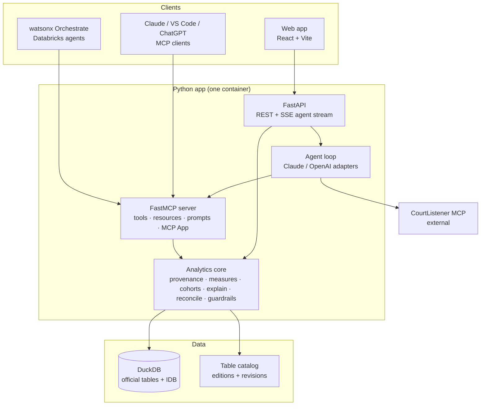

# Federal Courts Analyst: Build Plan

This folder splits the build into phases. Each phase has its own file with scope, tasks, design notes, a **test plan**, and **exit criteria**. We run them in order and don't start a phase until the previous one meets its exit criteria. Two exceptions: the eval benchmark (Phase 3) and the frontend design system (Phase 8a) can start early alongside other work.

**Repository:** [github.com/syedaun-techsur/federal-courts-analyst](https://github.com/syedaun-techsur/federal-courts-analyst) (private; built from the [GSA template](https://github.com/GSA-TTS/mcp-hackathon-template), whose history is kept and which stays available as the `template` git remote so we can pull upstream fixes)

Source concept: [`../Federal Courts Analyst — MCP Hackathon Concept.md`](../Federal%20Courts%20Analyst%20—%20MCP%20Hackathon%20Concept.md)

## How we win

The judges score four things. For each one, here's what should stand out:

| Criterion | Our winning move | Where it's built |
| --- | --- | --- |
| Technical quality | Clean core/adapter architecture, strict typing, >85% coverage, CI on every PR, deterministic eval harness | P0, P4, P5, P10 |
| Innovation | Edition-aware provenance, `explain_change` decomposition, cohort handles, guardrails that decline bad conclusions, an inline MCP App chart | P1, P4, P6, P9 |
| Mission alignment | Transparency about court workload for Congress, journalists and researchers, with neutral framing | P8, P11 |
| Presentation | A polished web app, a "vintage chart" that tells the 554→322 story in one picture, an eval dashboard showing lift over Genie and web search | P8, P10, P11 |

**The one-sentence pitch:** "Other AI tools give you *a* number. We give you *the right* number, tell you which edition it's from, and explain why the other official number differs."

## Phases

| # | Phase | Outcome | Depends on |
| --- | --- | --- | --- |
| 0 | [Foundations](phase-00-foundations.md) | Repo from GSA template, tooling, CI, spec/FastMCP spike | none |
| 1 | [Official tables catalog](phase-01-official-tables.md) | Edition-aware catalog of uscourts.gov tables in DuckDB, golden figures locked | P0 |
| 2 | [IDB ingestion](phase-02-idb-ingestion.md) | Civil IDB FY2015–FY2025 decoded in DuckDB, reproducible build | P0 |
| 3 | [Eval benchmark v1](phase-03-eval-benchmark.md) | Question bank, deterministic scorer, held-out split (drives everything after) | P1 (can start with P1) |
| 4 | [Analytics core](phase-04-analytics-core.md) | Provenance model, measures registry, cohorts, `explain_change`, reconciliation | P1, P2 |
| 5 | [MCP server](phase-05-mcp-server.md) | 9 tools (the concept's 8, with find/analyze split into two), resources, prompts, structured outputs, elicitation | P4 |
| 6 | [Guardrails and security](phase-06-guardrails-security.md) | Small-cell rules, PII suppression, no judge rankings, data-break warnings, threat model | P5 |
| 7 | [Agent service and API](phase-07-agent-api.md) | FastAPI streaming agent (our MCP + CourtListener MCP) plus REST for the explorer | P5 |
| 8 | [Web frontend](phase-08-frontend.md) | Polished React app: Ask, Explore map, Edition Tracker, Court profiles, Eval dashboard | P7 (8a design system can start at P4) |
| 9 | [MCP App and deployment](phase-09-mcp-app-deploy.md) | Inline chart MCP App, Databricks Apps deploy, watsonx/ContextForge registration | P5, P8 |
| 9b | [Request desk](phase-09b-request-desk.md) (proposed) | Sandboxed write workflow: ask the statistics office, verified copies, notify on change, a public answer library | P5–P8; runs alongside P9, before P10's held-out run |
| 10 | [Full evaluation](phase-10-full-evaluation.md) | Baselines (web search, Genie), multiple models, MLflow and Phoenix, results dashboard | P3, P7 |
| 11 | [Submission and demo](phase-11-submission.md) | Deck, evaluation document, demo script and video, rehearsals | all |

## Working agreement for Claude (how each phase is executed)

**Status:** we're already registered for the hackathon. Eligibility and registration aren't blockers.

Claude executes the phases one at a time and follows these rules in every phase:

1. **Validate your own code.** Write and run the tests for everything you build (unit, integration, MCP protocol, API, frontend, as listed in the phase file). Don't report a task as done until its tests pass locally. If something fails, fix it or report it plainly with the output.
2. **Use local Docker.** Docker is running on this machine. Use it to build and run the app the way it will be deployed (the container image, DuckDB, the FastAPI + MCP server, the web build), and run integration and e2e tests against the running container, not just in-process.
3. **Test in Chrome at the end of every phase.** After the automated tests pass, use Claude in Chrome to exercise everything the phase built through a real browser:
   - Web pages (once they exist): click through the journeys, check layout, dark mode and mobile width, look for console errors
   - Before the frontend exists: the MCP Inspector, the API docs (`/docs`), `/health` and `/version`, and any generated reports
   Record what was tested and any issues in the phase's "Evidence" section, and fix issues before closing the phase.
4. **Improve on the plan.** These plans are a starting point, not a contract. If you find a better approach, library, data source or design while working, use it. Record the change and the reason in the phase file (a "Deviations" section) or an ADR, and update later phases if they're affected.
5. **Search the web when it helps.** Check current docs (FastMCP, MCP spec, Databricks, watsonx, library APIs), uscourts.gov and FJC data details, codebooks, and best practices whenever you're unsure, instead of guessing. Cite the sources you relied on in `docs/`.
6. **End-of-phase report.** When a phase is finished, summarize what was built, test results (counts and coverage), the Chrome check, deviations from the plan, and any open issues. Then wait for the go-ahead before starting the next phase.
7. **Track open issues on GitHub.** The [issue tracker](https://github.com/syedaun-techsur/federal-courts-analyst/issues) is the live list of open issues; each phase file's "Open issues" section is a snapshot that links to it.
   - **When a phase finishes:** file every actionable open issue as a GitHub issue (skip duplicates of existing ones and pure notes about workarounds already applied). Use one issue per decision or piece of work, with the context, a "Done when" line and links to the phase file. Label it with the phase it came from (`phase N`), the phase that should fix it if that's different, and any of `needs domain expert`, `needs team`, `data`, `dev environment`, `stretch`. Then link the issue numbers from the phase file.
   - **While working:** before starting a phase, read the open issues labelled for it. When work resolves one, close it from the PR (`Closes #N`) or comment with what changed. When new information changes one, comment on it rather than opening a duplicate.
   - Filing, commenting on and closing issues in this repo doesn't need asking. Anything that reaches outside the repo (emailing the AO, submitting to the Wayback Machine) still does.

## Architecture



**Key principle: one core, several thin adapters.** All the logic (figures, provenance, decomposition, guardrails) lives in `core/`, which knows nothing about MCP or HTTP. MCP tools and REST endpoints are thin wrappers around it. That gives us:
- Unit tests that don't need an MCP client
- The web explorer and the MCP tools can never disagree, because they call the same code
- A good slide for "technical quality"

## Tech stack

| Layer | Choice | Why |
| --- | --- | --- |
| Language | Python 3.12 (container and dev); 3.11 floor for deploy hosts, and CI tests both | Template and FastMCP |
| Packaging | `uv`, plus a mirrored `requirements.txt` | Template convention |
| MCP | FastMCP 4 (`>=4.0.10,<5`, MCP spec 2026-07-28; see [ADR 0001](../docs/adr/0001-mcp-capabilities.md)) | Template; Pydantic-native tools and output schemas |
| Models | Pydantic v2 | Judges explicitly look for Pydantic inputs |
| Storage | DuckDB + Parquet | Fast analytical SQL, a single file, no server |
| Scraping and parsing | httpx, openpyxl/calamine, pdfplumber (PDF fallback) | Official tables come as xlsx and PDF |
| API | FastAPI + SSE | Streams agent events to the web app |
| Agent | Anthropic SDK (Claude default) + OpenAI adapter behind one interface | Multi-model eval; OpenAI is a hackathon partner |
| Frontend | React 19 + TypeScript + Vite, Tailwind CSS v4, shadcn/ui (Radix), TanStack Router and Query | Fast, accessible, looks great, builds to static files the Python app serves (one container to deploy) |
| Charts | Observable Plot (charts), d3-geo + TopoJSON (district map), Motion (transitions) | Editorial-quality charts with little code |
| MCP App | Vite single-file bundle sharing the web app's chart components | One design system everywhere |
| Eval | pytest-based harness + MLflow (Databricks kit) + Arize Phoenix (OpenInference traces) | Template evaluation kits the judges will recognize |
| Quality | ruff, mypy (strict on `core/`), pytest, hypothesis, syrupy, coverage; ESLint, Vitest, Playwright, axe | See testing strategy |

## Repository layout (target)

Keeps the template's structure so its deploy kits work unchanged, and adds `core/`, `pipeline/`, `api/` and `web/`.

```
MCP-Test/                         # becomes the repo root (forked from GSA template)
├── src/courts_analyst/           # renamed from example_server
│   ├── app.py                    # template entry point (stdio / HTTP)
│   ├── config.py
│   ├── models.py                 # shared Pydantic models (Provenance, enums)
│   ├── tools/                    # one file per tool, register(mcp)
│   ├── resources/
│   ├── prompts/
│   ├── core/                     # pure domain logic, no MCP/HTTP imports
│   ├── pipeline/                 # data ingestion: tables scraper, IDB loader
│   ├── api/                      # FastAPI: REST + agent SSE + serves web build
│   └── agent/                    # model adapters, MCP client wiring
├── web/                          # React app (+ mcp-app entry)
├── eval/                         # benchmark, scorers, runners, results
├── data/                         # gitignored build outputs; manifests committed
├── tests/                        # unit / integration / mcp / contract
├── deploy/                       # template kits (databricks, ibm)
├── docs/                         # methodology, ADRs, variance report
└── plan/                         # this folder
```

## Testing strategy (applies to every phase)

Every phase ships with tests, and CI must be green before the phase is closed.

| Layer | Tooling | What it covers |
| --- | --- | --- |
| Unit | pytest, hypothesis | Pure functions in `core/` and `pipeline/`; property tests (for example, decomposition parts always sum to the total) |
| Golden figures | pytest + `tests/golden/*.yaml` | Known official values (676, 675, 554, 322, 673/674 judgeships…) must come out exactly, with the right edition |
| Snapshot | syrupy | Tool output JSON shapes and provenance blocks; catches accidental contract changes |
| Integration | pytest + a small committed fixture DB | Pipelines end to end on fixture files; DuckDB queries |
| MCP protocol | FastMCP in-memory `Client` | List tools, validate input and output schemas, call every tool, check errors, resources, prompts, elicitation fallback |
| API | httpx `AsyncClient` + FastAPI | REST contracts, SSE event sequence, error codes |
| Frontend unit | Vitest + Testing Library + MSW | Components, formatting, provenance badges, state |
| Frontend e2e | Playwright | Key user journeys against a mocked and a live backend |
| Visual and a11y | Playwright screenshots, axe-core, Lighthouse CI | No visual regressions; WCAG 2.1 AA; performance budget |
| Evaluation | `eval/` harness (P3, P10) | Agent accuracy, tool selection, adversarial behavior, latency |

**CI gates:** ruff, mypy, pytest with coverage ≥ 85% on `core/` and ≥ 75% overall, frontend lint, typecheck, unit tests, and Playwright smoke. A nightly job runs the full eval on a small model budget.

**Test data rule:** CI never downloads the 22 GiB IDB or scrapes uscourts.gov. We commit small, representative fixtures (a few thousand IDB rows, a handful of real xlsx and PDF tables). Full-data tests run locally or nightly behind a `@pytest.mark.fulldata` marker.

## Timeline (working backwards; final deadline not yet announced)

| Week of | Phases | Milestone |
| --- | --- | --- |
| Sep 28 | P0, P1 start | Repo, CI and MCP capability matrix in place |
| Oct 5 | P1, P2, P3 start | Golden figures pass |
| Oct 12 | P2, P3, P4 | **Kickoff Oct 13**: architecture and data ready |
| Oct 19 | P4, P5, 8a design system | First tools callable from Claude |
| Oct 26 | P5, P6 | MCP 201 Oct 29: all tools plus guardrails |
| Nov 2 | P7, P8, P10 baselines | **Halfway check-in Nov 3**: demo MCP server + eval v1 numbers |
| Nov 9 | P8, P9 | Web app feature-complete |
| Nov 16 | P9, P10 | Deployed; full eval results |
| Nov 23 | P11 | Deck, eval doc, video; freeze |

GSA estimates about 40 hours. This plan is deliberately bigger than that because we're trying to win. Items marked **(stretch)** in each phase can be cut without breaking the story.

## Proposed decisions (confirm before P1)

1. **Default edition:** return the **latest** edition's figure by default, and always attach `first_published` plus the revision history when they differ. That serves "what's the current official number" and still surfaces the 554 vs 322 story.
2. **Scope:** civil FY2015–FY2025 first. Criminal is a stretch goal.
3. **Small-cell threshold:** warn when n < 30, suppress when n < 10 (confirm with the domain expert).
4. **CourtListener handoff:** part of the core demo, but the demo must still work if it's unavailable (cached fallback).
5. **Frontend:** Vite SPA served by the same Python container, so there's a single deploy on Databricks Apps.
6. **Package name:** `courts_analyst` as a placeholder until we pick a product name.

## Definition of done (every phase)

- [ ] All tasks checked off or explicitly moved to a later phase or cut
- [ ] Tests written and passing in CI; coverage gates met
- [ ] Integration/e2e tests pass against the app running in local Docker
- [ ] Claude in Chrome walkthrough done; issues fixed; findings recorded under "Evidence"
- [ ] Any deviations from the plan recorded (phase file "Deviations" section or an ADR)
- [ ] Open issues filed on GitHub (or linked to existing ones) and the phase file's "Open issues" section links them; issues this phase resolved are closed
- [ ] Public functions and every MCP tool have precise docstrings/descriptions
- [ ] `docs/` updated (methodology, ADR if a design decision was made)
- [ ] Short demo (screenshot, clip or transcript) added to the phase's "Evidence" section, which we'll reuse for the deck
